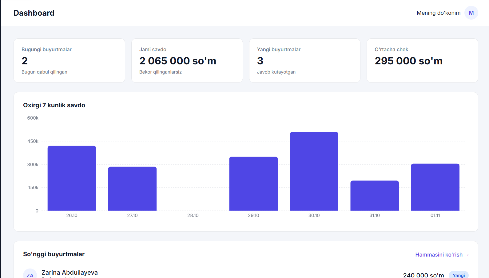
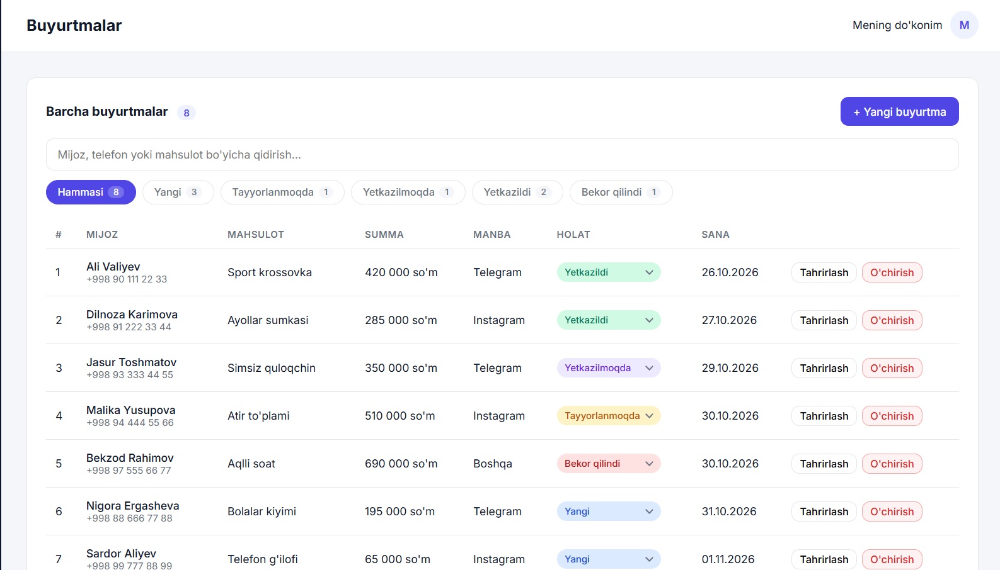
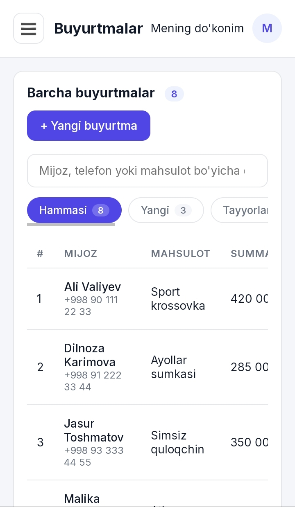

<div align="center">


<a href="https://daftar-teal.vercel.app">
  
</a>

<br/>

<a href="https://daftar-teal.vercel.app">
  
</a>
<a href="https://github.com/Samirjon018/Daftar">
  
</a>

<br/><br/>


</div>

---

## ✨ Daftar nima?

Instagram va Telegram orqali sotadigan kichik sotuvchilar buyurtmalarni ko'pincha chatlarda, daftarda yoki xotirada saqlaydi. **Daftar** shu tartibsizlikni bitta chiroyli panelga yig'adi: kim, nima, qancha va qaysi holatda buyurtma qilgani doim ko'z oldingizda.

---

## 🎯 Imkoniyatlar

| | Imkoniyat | Tavsif |
|---|---|---|
| 🧾 | **Buyurtmalar** | Qo'shish, tahrirlash va o'chirish, validatsiyali forma bilan |
| 🔄 | **Holatlar** | Yangi → Tayyorlanmoqda → Yo'lda → Yetkazildi / Bekor qilindi |
| 🔍 | **Qidiruv va filtr** | Mijoz, telefon yoki mahsulot bo'yicha, holat tablari bilan |
| 👥 | **Mijozlar** | Buyurtmalardan avtomatik yig'iladigan mijozlar ro'yxati |
| 📊 | **Dashboard** | Statistika kartochkalari, 7 kunlik daromad grafigi, oxirgi buyurtmalar |
| 💾 | **Saqlash** | Ma'lumotlar brauzerda (localStorage), sahifa yangilansa yo'qolmaydi |
| 📱 | **Moslashuvchan** | Kompyuter, planshet va telefon uchun alohida ko'rinish |

---

## 📸 Skrinshotlar

<div align="center">

### Dashboard


<br/><br/>

### Buyurtmalar


<br/><br/>

### Telefon ko'rinishi


</div>

---

## 🛠 Texnologiyalar

- **React 19 + Vite**: tezkor interfeys va dev server
- **React Router**: Dashboard, Buyurtmalar va Mijozlar sahifalari
- **Recharts**: daromad grafigi
- **Custom hook (`useLocalStorage`)**: ma'lumotlarni brauzerda saqlash
- **Sof CSS**: hech qanday UI kutubxonasiz, CSS o'zgaruvchilari va media-querylar bilan

<details>
<summary><b>📁 Loyiha tuzilishi</b></summary>

```text
src/
├── components/
│   ├── Sidebar.jsx      # yon menyu (telefonda surilib chiqadi)
│   ├── Topbar.jsx       # sarlavha va ☰ tugmasi
│   └── OrderForm.jsx    # yangi buyurtma / tahrirlash formasi
├── pages/
│   ├── Dashboard.jsx    # statistika va grafik
│   ├── Orders.jsx       # buyurtmalar jadvali
│   └── Customers.jsx    # mijozlar ro'yxati
├── hooks/
│   └── useLocalStorage.js
├── data/
│   └── orders.js        # namunaviy ma'lumotlar
├── utils/
│   └── format.js        # narx, sana, telefon formatlash
├── App.jsx
└── App.css
```

</details>

---

## 🚀 Ishga tushirish

```bash
git clone https://github.com/Samirjon018/Daftar.git
cd Daftar
npm install
npm run dev
```

Brauzerda `http://localhost:5173` ni oching.

---

## 🗺 Kelajak rejalari

- [x] Buyurtmalarni qo'shish, tahrirlash, o'chirish
- [x] Qidiruv va holat bo'yicha filtr
- [x] Dashboard va daromad grafigi
- [x] Telefon uchun moslashuv
- [x] Vercel ga joylash
- [ ] Qorong'i rejim
- [ ] Buyurtmalarni Excel/CSV ga yuklab olish
- [ ] Backend va haqiqiy ma'lumotlar bazasi

---

<div align="center">

### 👨‍💻 Muallif

**Samirjon Abdurakhimov**
Web dasturlash o'quvchisi · One World Academy, Samarqand

<a href="https://github.com/Samirjon018">
  
</a>

<br/>

⭐ Loyiha yoqqan bo'lsa, yulduzcha qo'yishni unutmang!


</div>